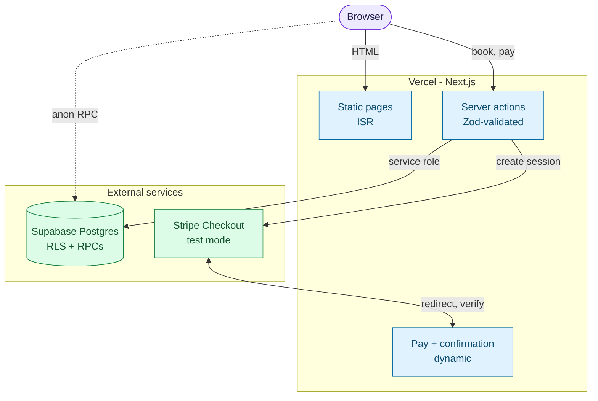

# justhairs

Guest booking flow for a unisex hair salon: pick a service and a stylist, choose a
slot, and either pay by card (Stripe Checkout, test mode) or pay at the salon. No
accounts.

**Live demo:** [justhairs.vercel.app](https://justhairs.vercel.app) ·
**Stack:** Next.js 16 (App Router), React 19, TypeScript (strict), Tailwind v4,
Supabase (Postgres + RLS), Stripe, Playwright

## Scope

| In | Out (schema exists where noted) |
| --- | --- |
| Catalog, team, ratings, map, dark mode | Accounts / login (removed in migration `0003`) |
| 4-step booking: service → specialist → date & time → review | Admin panel (tables exist) |
| Guest details, Stripe Checkout (test mode) or pay-later | Email / SMS notifications (tables exist) |
| Confirmation page with reference code | Self-service reschedule / cancel |

## Architecture



- The anon key can only call the availability RPCs; appointment rows (contact details) are read server-side with the service-role key.
- No webhook: after payment, Stripe redirects to the confirmation page, which verifies the session and marks the appointment paid.

Public pages are prerendered and revalidated (ISR). Only `/book/pay/[id]` and
`/book/confirmation/[id]` are dynamic, because they read one live appointment.
Availability and booking run in `SECURITY DEFINER` Postgres functions; appointment
rows contain contact details and are never readable with the anon key.

## Key design decisions

| Decision | Why | Tradeoff |
| --- | --- | --- |
| Booking state lives in the URL (`?service&staff&date&time&step`) | Deep links, working Back/Forward, clickable step tabs; `goToStep` clears dependent params | Every transition is a navigation; URL and component state must be kept in sync (see `BookingFlow.tsx`) |
| Availability + booking as Postgres RPCs | One source of truth for slot generation, shared by UI and server | Logic lives in SQL migrations, not TypeScript |
| Client slot cache on `useSyncExternalStore`, 14-day prefetch via `get_day_availability` | Date and time steps render from cache; "Next available" chips need no extra round trip | Hand-rolled cache; the grid is guarded so it never shows data for a different (day, staff) than the selection |
| Stripe reconcile-on-return, no webhook | Runs on any hosting tier, no endpoint to register | A guest who pays and never returns to the site is not reconciled (see limitations) |
| Guest checkout | Fewer steps to a booking | No ownership model for an appointment beyond its id |
| Zod on every action input, `z.guid()` for ids | Validation at the trust boundary | `z.uuid()` rejects the non-RFC-4122 ids used in seed data |
| Design tokens + Tailwind v4 `@theme` + `tailwind-variants` | One spacing scale (`--gutter`), one elevation language, pages compose rather than style | Local component library to maintain (`src/components/ui`) |

Accessibility measures in code: contrast-tuned text tokens, `radiogroup`/`radio`
semantics for the date strip and time grid, a single `focus-visible` ring,
`prefers-reduced-motion` handling for scroll and transitions. There is no
automated accessibility audit in CI yet.

## Quality gates

- `npx tsc --noEmit` and `eslint --max-warnings 0` (includes the React Compiler
  lint rules) are expected clean on every commit.
- Playwright regression suite against a **deployed** URL, never localhost — see
  [Regression testing](#regression-testing).

## Getting started

Prerequisites: Node.js 20+, a Supabase project, optionally a Stripe test account.

```bash
npm install
cp .env.example .env.local   # then fill in the values below
```

| Variable | Required | Scope | Purpose |
| --- | --- | --- | --- |
| `NEXT_PUBLIC_SUPABASE_URL` | yes | client + server | Supabase project URL |
| `NEXT_PUBLIC_SUPABASE_ANON_KEY` | yes | client + server | Anon key (RLS-protected) |
| `SUPABASE_SERVICE_ROLE_KEY` | yes | server only | Reads appointments; test cleanup |
| `STRIPE_SECRET_KEY` | no | server only | `sk_test_…`; without it only "pay later" works |
| `NEXT_PUBLIC_SITE_URL` | yes | client + server | Stripe return URL (`http://localhost:3000` locally) |
| `TEST_PROD_URL`, `TEST_PREVIEW_URL` | tests only | Playwright | Deployment under test |

Set up the database: enable the `pg_cron` extension (Supabase → Database → Extensions),
then paste [`supabase/setup.sql`](supabase/setup.sql) into the SQL editor and run it. It is
the whole schema, booking RPCs, cron jobs and the demo salon in one file.

Already have a project? `supabase/setup.sql` is for a fresh database only — apply just the newer
files in `supabase/migrations/` (or `supabase db push`). `setup.sql` is generated from the
migrations + `seed.sql` by `npm run db:setup`, and CI checks it is up to date.

```bash
npm run dev
```

### Scripts

| Command | What it does |
| --- | --- |
| `npm run dev` / `build` / `start` | Next.js dev server / production build / serve build |
| `npm run lint` | ESLint |
| `npm run db:setup` | Regenerate `supabase/setup.sql` from the migrations + seed (`db:setup:check` verifies it) |
| `npm run test:smoke` | Route + RPC checks against `TEST_PROD_URL` |
| `npm run test:e2e` | Full booking flows, incl. Stripe test payment |
| `npm run test:smoke:preview`, `test:e2e:preview` | Same, against `TEST_PREVIEW_URL` |
| `npm run playwright:install` | Install Chromium for Playwright |
| `node --env-file=.env.local scripts/seed-demo.mjs` | Demo visits, reviews, reservations (tagged `*@justhairs.test`, idempotent) |
| `node --env-file=.env.local scripts/sync-catalog.mjs` | Push catalog changes to a live DB |
| `node --env-file=.env.local scripts/gen-blur.mjs` | Regenerate `src/lib/blur.generated.ts` (commit the result) |

Optional: regenerate DB types with
`npx supabase gen types typescript --project-id <ref> > src/lib/supabase/types.gen.ts`.
The app currently uses hand-authored types in `src/lib/supabase/types.ts`.

## Deployment

Import the repo in Vercel, add every variable from `.env.example`, and set
`NEXT_PUBLIC_SITE_URL` to the deployed URL. There is no webhook to register.

## Regression testing

Playwright against the real deployed site: a fast smoke suite and a slower
end-to-end suite that books and pays (Stripe **test mode**) for real.

```bash
npm run playwright:install   # once
npm run test:smoke           # seconds: routes respond, RPCs callable
npm run test:e2e             # 1–2 min: book, pay, confirm, clean up
```

- **`tests/smoke/`** — HTTP checks plus a direct anon-key call to
  `get_available_slots` / `get_day_availability`. Asserts that
  `/book/pay/<bogus-id>` and `/book/confirmation/<bogus-id>` currently return
  HTTP **200** with "Page not found" (a known bug,
  [`CODE_REVIEW.md` #19](./CODE_REVIEW.md)); asserted as-is so it cannot get worse unnoticed.
- **`tests/e2e/`** — real Chromium through the UI: catalog, pay-later booking,
  pay-now with Stripe's `4242…` test card, and step-tab / back-button navigation.
  The Stripe test drives hosted Checkout and skips itself if the deployment has no
  `STRIPE_SECRET_KEY`.
- Every test that creates an appointment deletes exactly that row afterwards
  (`tests/support/cleanup.ts`, service-role key), pass or fail.
- **CI:** `.github/workflows/smoke-pr.yml` runs the smoke suite as a pull-request
  check (job `smoke`) against that PR's Vercel preview, waiting for the deployment
  to go green first. `.github/workflows/regression.yml` runs on the `deployment_status`
  event Vercel posts for production deploys: smoke plus e2e. Secrets: `NEXT_PUBLIC_SUPABASE_URL`,
  `NEXT_PUBLIC_SUPABASE_ANON_KEY`, `SUPABASE_SERVICE_ROLE_KEY`. Failed runs upload
  the HTML report (trace + screenshot).

## Project layout

```
src/
  app/
    page.tsx                     Home
    services/                    List + detail (static / ISR); ?staff= filters by stylist
    masters/                     Team (static / ISR)
    book/                        4-step flow (BookingFlow.tsx)
    book/pay/[id]/               Guest details + Stripe Checkout / pay-later
    book/confirmation/[id]/      Reference code + status (reconciles the Stripe session)
  components/
    ui/                          Design-system components
    layout/ marketing/ theme/    App shell, hero/footer/map, theme toggle
  lib/
    supabase/                    anon + service-role clients, domain types
    actions/booking.ts           Zod-validated server actions (book, pay, checkout)
    slot-cache.ts                useSyncExternalStore availability cache
    queries.ts, appointments.ts  Catalog reads; appointment read + Stripe reconcile
    stripe.ts                    Stripe client (null without a key)
supabase/
  migrations/                    Ordered history, 0001–0006 (upgrade path for an existing project)
  setup.sql                      Generated one-shot bundle: all migrations + seed (fresh install)
  seed.sql                       Demo salon, services, staff, hours
scripts/                         seed-demo, sync-catalog, gen-blur, build-setup-sql
tests/                           smoke/, e2e/, support/
CODE_REVIEW.md                   Self-review: 23 tracked findings
```

## Booking engine

`get_available_slots(service_id, staff_id, day)` and `book_appointment(...)` are
`SECURITY DEFINER` functions callable by the anon role. Slots come from each
staff member's `staff_working_hours` for the weekday, minus `staff_time_off` and
existing appointments, stepped by `app_settings.slot_step_min`. "Any specialist"
collapses to distinct times and a concrete stylist is assigned at booking.
`book_appointment` re-checks availability inside its transaction and stamps a short
confirmation code. Under Postgres's default isolation level that check is not
serialized, so two concurrent bookings of the same slot can both succeed — see
limitation 1 below. Contact details and payment are collected on the next screen;
after a card payment the confirmation page verifies the Checkout session and sets
`payment_status` to `paid`.

## Known limitations

Tracked in full, with fix directions, in [`CODE_REVIEW.md`](./CODE_REVIEW.md).
The ones that matter most:

1. **No database-level double-booking guard** — needs a `GiST` exclusion constraint
   or row lock (#1).
2. **Appointment mutations trust a bare id** — `abandonBooking`, `payLater`,
   `startCheckout` have no ownership check; `abandonBooking` can race a payment (#2, #3).
3. **No Stripe webhook** — a paid session is only reconciled if the guest returns.
4. **`notFound()` responds 200** on the two dynamic booking routes (#19).
5. **No PR-level CI gate** (lint / typecheck / build) and **no unit tests** — coverage
   is live-site e2e only (#21, #23).

Roadmap: exclusion constraint + hold tokens, Stripe webhook, notifications, admin panel.
