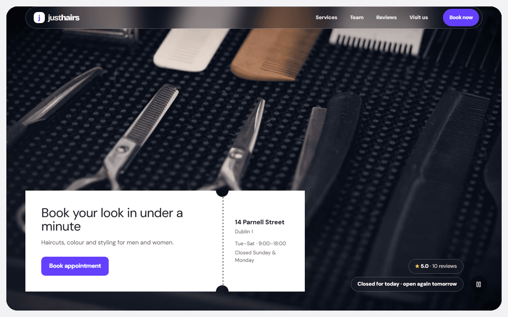
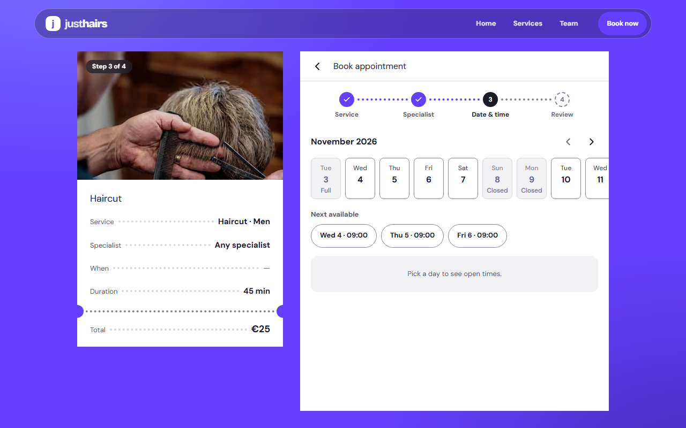
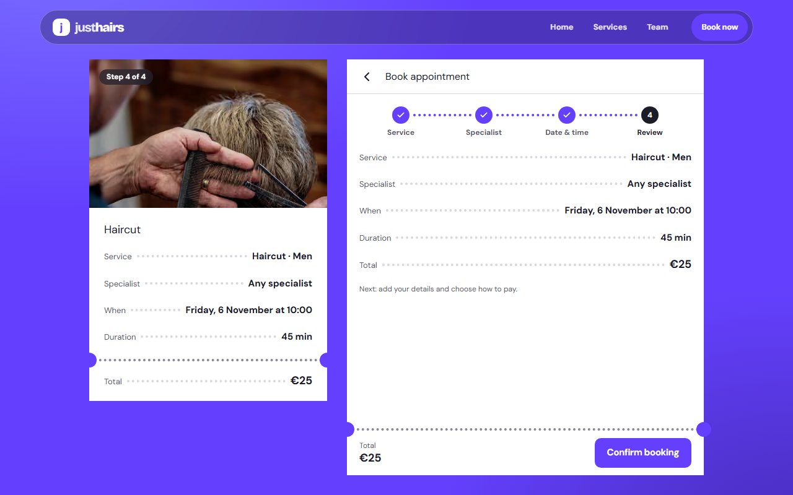
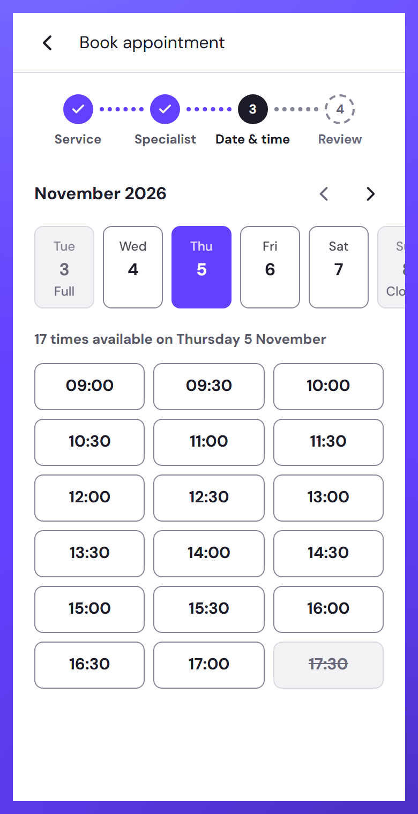
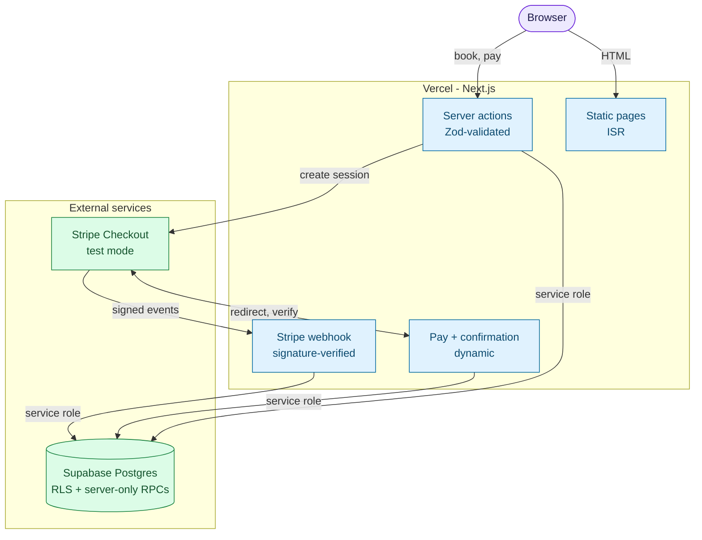

# justhairs

Online booking for a unisex hair salon: pick a service and a specialist, choose a
free slot and confirm in under a minute, paying by card (Stripe test mode) or at the
salon. No account needed.

[](https://nextjs.org)
[](https://www.typescriptlang.org)
[](https://supabase.com)
[](https://stripe.com/docs/test-mode)

**Live demo: [justhairs.vercel.app](https://justhairs.vercel.app)**



> **Demo status.** Payments run in Stripe **test mode** (no real money moves; use
> Stripe's test card). The demo shares one Supabase database with the automated tests,
> so bookings made there are demo data.

## What it does

- Service catalog with prices and durations: 11 services for men and women.
- Team page with 7 specialists, their services, working hours and ratings; customer reviews on the home page.
- 4-step booking: service, specialist, date and time, review. Availability is live, and "any specialist" assigns a free person at booking time.
- Guest checkout with no account: pay by card through Stripe Checkout (test mode) or pay at the salon.
- Confirmation page with a reference code and an add-to-calendar file (.ics).
- Map, opening hours and an "open today" indicator.
- Dark mode, reduced-motion support and an installable web app manifest.
- SEO basics: sitemap, robots, Open Graph image and structured data.

## Why it is reliable

- **No double-booking.** A Postgres exclusion constraint on each specialist's time range rejects overlapping appointments, so two people racing for the same slot cannot both win.
- **Payments are confirmed twice.** A signature-verified Stripe webhook records the payment, and the confirmation page also verifies the session when the guest returns.
- **Booking links are private.** Each booking carries a secret token held in an HttpOnly cookie, so a leaked appointment link cannot be used to view or change someone else's booking.
- **Inputs are validated on the server** (Zod) for every action, and the booking functions can only be called by the server, never directly with the public key.
- **Row-level security is on for every table**, and guest contact details are not readable with the public key.

## Quality you can see

About 130 automated tests across four layers, plus a CI gate on every pull request.

| Layer | What it covers | Size |
| --- | --- | --- |
| Unit (`tests/unit`) | Stripe webhook handling, calendar file, opening-hours label, salon time zone | about 37 tests, 4 files |
| Database (`tests/db`) | Every migration and the seed on in-memory Postgres: grants and RLS, booking rules, payments, upgrade path, generated types | about 48 tests, 4 files |
| Smoke (`tests/smoke`) | Routes, access rules, booking UI, layout invariants, an axe accessibility scan in light and dark; also run on a phone-sized viewport | about 30 tests, 5 files |
| End to end (`tests/e2e`) | Real bookings through the UI, including a Stripe test-mode payment | about 13 tests, 4 files |

On every pull request, GitHub Actions runs: generated-SQL freshness check, database tests, unit tests, lint, type check and a production build ([`ci.yml`](.github/workflows/ci.yml)); and the smoke suite against that PR's Vercel preview ([`smoke-pr.yml`](.github/workflows/smoke-pr.yml)). A third workflow runs smoke and end-to-end tests after production deploys ([`regression.yml`](.github/workflows/regression.yml)).

## Screenshots

| Date and time | Review | On a phone |
| --- | --- | --- |
|  |  |  |

Photos are free stock from Pexels; credits are in [`public/ds/CREDITS.md`](public/ds/CREDITS.md).

## How it is built

Next.js 16 (App Router, React 19), TypeScript in strict mode, Tailwind CSS v4, Supabase (Postgres with row-level security) and Stripe Checkout, deployed on Vercel.



Key design decisions:

- **The booking is described by the URL** (`?service&staff&date&time&step`), so steps can be deep-linked and Back/Forward work.
- **Rules live in Postgres.** Slot generation, the booking itself and payment recording are database functions, so there is one source of truth and the double-booking guard is enforced by the database.
- **Public pages are prerendered** and revalidated; only the pay and confirmation pages, which read one live appointment, are dynamic.
- **The browser-visible key reaches only the public catalog.** Everything private goes through the server with the service-role key.
- **Design tokens and a small component library** keep spacing, elevation and type consistent ([`docs/design.md`](docs/design.md)).

More detail: [`docs/development.md`](docs/development.md) (scripts, layout, testing, booking engine) and [`docs/supabase.md`](docs/supabase.md) (access model, migrations, webhook).

## Run it locally

Prerequisites: Node.js 22.18 or newer, a Supabase project, optionally a Stripe test-mode account.

```bash
npm install
cp .env.example .env.local   # then fill in the values below
npm run dev
```

| Variable | Required | Scope | Purpose |
| --- | --- | --- | --- |
| `NEXT_PUBLIC_SUPABASE_URL` | yes | client + server | Supabase project URL |
| `NEXT_PUBLIC_SUPABASE_ANON_KEY` | yes | client + server | Public key (RLS-protected catalog reads only) |
| `SUPABASE_SERVICE_ROLE_KEY` | yes | server only | Booking functions, appointments, payments |
| `NEXT_PUBLIC_SITE_URL` | yes | client + server | Stripe return URL (`http://localhost:3000` locally; required in production) |
| `STRIPE_SECRET_KEY` | no | server only | `sk_test_...`; without it only "pay at the salon" works |
| `STRIPE_WEBHOOK_SECRET` | no | server only | Signing secret of the webhook endpoint; without it the route answers 503 |
| `NEXT_PUBLIC_HERO_VIDEO` | no | client | Set to `1` to play the hero background video |
| `TEST_PROD_URL`, `TEST_PREVIEW_URL` | tests only | Playwright | Deployment under test |

Database: enable the `pg_cron` extension (Supabase, Database, Extensions), then paste [`supabase/setup.sql`](supabase/setup.sql) into the SQL editor and run it. It contains the whole schema, the booking functions, the cron jobs and the demo salon. For an existing project, apply only the newer files in `supabase/migrations/`. Deployment: import the repo in Vercel and add the variables above; for payments, register the webhook endpoint `/api/stripe/webhook` as described in [`docs/supabase.md`](docs/supabase.md).

## Roadmap

Next steps for taking this from a demo to a production salon:

- Admin panel for staff, services and the calendar.
- Email and SMS confirmations and reminders.
- Self-service reschedule and cancel for guests.
- Live Stripe keys, and a separate staging database for automated tests.
